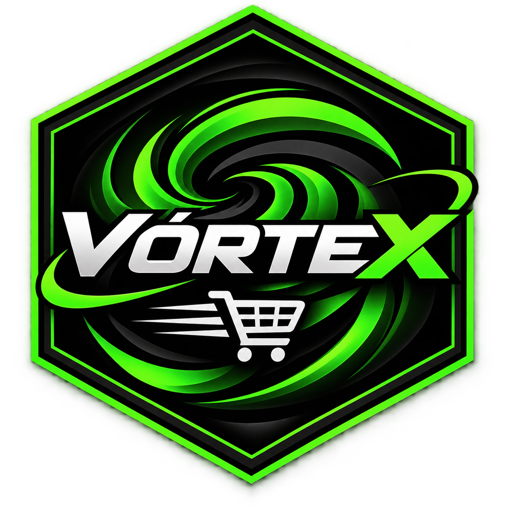

# VORTEX (Projeto Final)
Uma loja de jogos chamada Vortex (cadastro de jogos, clientes, vendas e produtos)

## Situação-problema

A loja de jogos VORTEX atua na comercialização de jogos de videogame e acessórios, como controles, headsets e outros produtos relacionados ao universo gamer.

Com o crescimento da popularidade da loja e o aumento da quantidade de clientes e produtos, surgiram dificuldades no gerenciamento das informações, no controle de estoque, no registro das vendas e na consulta do histórico de compras dos clientes.

Diante dessa necessidade, a loja entrou em contato com a gente e identificamos a importância de desenvolver um banco de dados que permita armazenar, organizar e relacionar essas informações de maneira eficiente e segura.

O projeto tem como objetivo desenvolver um banco de dados utilizando PostgreSQL, com tabelas destinadas ao cadastro de clientes, produtos, jogos, vendas e itens vendidos em cada compra. Dessa forma, será possível facilitar o gerenciamento da loja, melhorar o controle de estoque, acompanhar as vendas e agilizar a consulta de informações.

## 👥 Integrantes
- Kevin Daniel Santos Gomes
- Matheus Henrique Vasconcelos Barboza

**Professora:** Késsia Marchi
